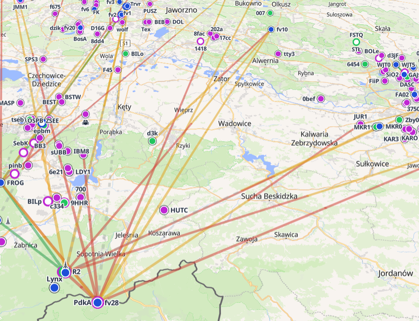
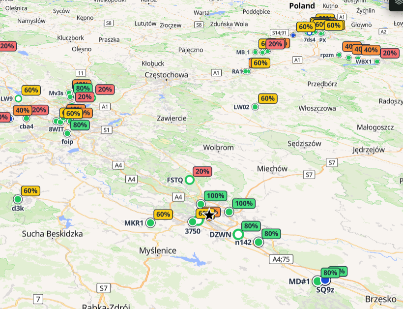
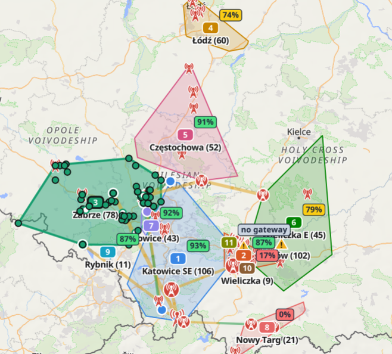
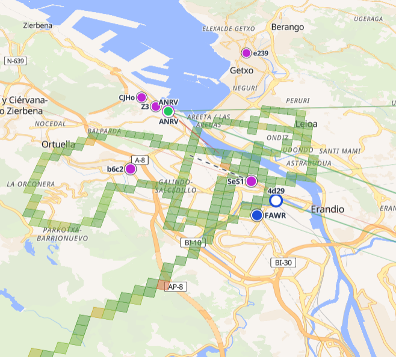
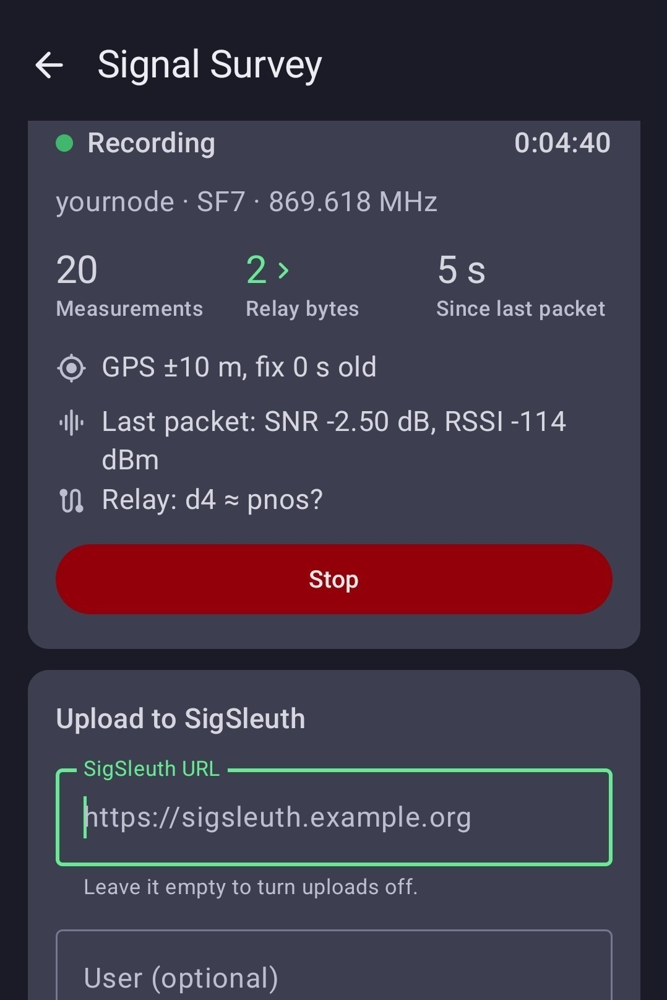
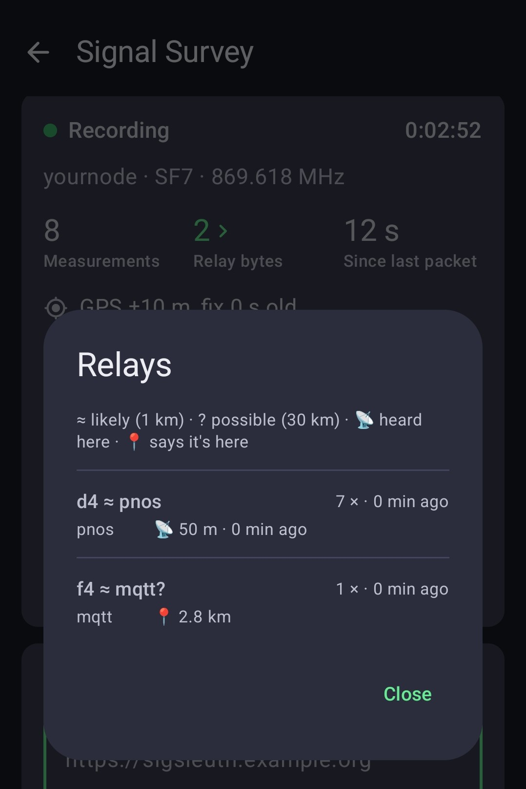

# SigSleuth

A map of your Meshtastic mesh, built from what gateways upload to MQTT. Among other things, it allows you to browse all the routes traceroutes take, analyse links and neighbours, where the nodes split into zones and how far text messages reach. With the [Mesh Survey](https://github.com/joroses/mesh-survey) app, users can contribute signal measurements to the map. Check https://sigsleuth.com for an example.

| | |
|---|---|
|  |  |
| Direct links | How far messages reach |
|  |  |
| Zones view | Coverage |

## Coverage

MQTT shows only what gateways hear. To see where your mesh can be heard on the ground, someone walks or drives with their node and [Mesh Survey](https://github.com/joroses/mesh-survey), a fork of the Meshtastic Android app. It records every packet the node hears, with the phone's position, and uploads them to a SigSleuth. On the Map, turn on **Coverage**: squares are coloured by their signal strength.

| | |
|---|---|
|  |  |
| Recording a survey | Which relays it heard through |

**If you run SigSleuth** and want surveys from others:

1. Set `SIGSLEUTH_UPLOAD_PASSWORD` in `.env` and serve SigSleuth over HTTPS ([a public server](docs/deployment.md#a-public-server)).
2. Give surveyors its address and the upload password.

Measurements will appear in the map

**If you want to survey** for a mesh that runs SigSleuth:

1. Install [Mesh Survey](https://github.com/joroses/mesh-survey/releases) and connect your node.
2. Ask whoever runs that SigSleuth for its address and upload password.
3. Open Settings → Advanced → Signal Survey, enter the address (`https://sigsleuth.example.org`), any user name and the password, and press Start.


## Try it

You need Docker. A Raspberry Pi is enough.

```bash
git clone https://github.com/joroses/sigsleuth && cd sigsleuth
cp .env.example .env
```

Edit `.env`. Its comments, copied from `.env.example`, explain every setting; these are the ones to set:

```bash
# Meshtastic's public broker, to try it out. For your mesh, use the broker
# its gateways upload to (TLS true if it needs TLS).
SIGSLEUTH_MQTT_HOST=mqtt.meshtastic.org
SIGSLEUTH_MQTT_PORT=1883
SIGSLEUTH_MQTT_TLS=false
SIGSLEUTH_MQTT_USERNAME=meshdev
SIGSLEUTH_MQTT_PASSWORD=large4cats
# What to record: one region, such as msh/US/# or msh/EU_868/#
SIGSLEUTH_MQTT_TOPIC=msh/EU_868/#
# Shown beside "SigSleuth" (optional)
SIGSLEUTH_NAME=My Mesh
# Password for Diagnostics (/#diagnostics); empty leaves it open
SIGSLEUTH_ADMIN_PASSWORD=
# Password Mesh Survey phones upload with; empty refuses uploads
SIGSLEUTH_UPLOAD_PASSWORD=
```

```bash
docker compose up -d
```

Open http://127.0.0.1:8000. The page fills in as packets arrive: nodes and links first, zones and text reach as traceroutes and texts build up. The public broker shows nodes, positions and chat, but carries almost no traceroutes, so links and zones stay sparse there.

To update: `git pull && docker compose pull && docker compose up -d`.

- History is kept 14 days (`SIGSLEUTH_RETENTION_DAYS`): about 1.2 GB for a busy region, plus [working space](docs/deployment.md#retention-and-disk).
- **Diagnostics** is linked only in a browser that has opened it: open http://127.0.0.1:8000/#diagnostics once, and the bar shows it from then on. Its tabs show what capture saved and skipped and why, nodes with doubtful positions, conflicting device reports (with the node numbers several radios share at once), long links to review, relay checks against traceroute routes and recent packets.
- Nodes with OK to MQTT off are kept in history but never shown; turning it on shows them again, history included. `SIGSLEUTH_HIDE_OPTED_OUT=false` shows them anyway.
- There are no accounts: anyone who can reach the page sees everything but Diagnostics. Passwords are sent in the clear, so serve SigSleuth over HTTPS before using them from another machine: see [running and deploying](docs/deployment.md).

## More

- [Running and deploying](docs/deployment.md): updates, disk, a public server.
- [Development setup](docs/setup.md) and [testing](docs/testing.md).
- [Glossary](docs/glossary.md) of the terms the pages use.
- Coding agents: read [AGENTS.md](AGENTS.md).

Code: `src/backend/sigsleuth/` is the Python capture and API (`mqtt.py` receives, `decode.py` reads, `ingest.py` saves, `derive.py` keeps the derived tables current, `maintenance.py` rebuilds them and trims old history in the background, `api.py` serves; facts in `schema.sql`, derived tables in `derived.sql`; the running app lists the API at `/docs`). `src/frontend/` is the page (React, TypeScript, MapLibre). Backend tests are in `tests/`; frontend tests sit beside their components.

## Licence

[AGPL-3.0](LICENSE). If you run a modified SigSleuth for others over a network, offer them its source: point the Source link in the page (`SOURCE_URL` in `src/frontend/src/app/ui.tsx`) at your copy.

## Credits

Place names for zones come from [GeoNames](https://www.geonames.org/) (CC BY 4.0), terrain heights from the [Mapzen Terrain Tiles](https://github.com/tilezen/joerd/blob/master/docs/attribution.md) on AWS open data, and basemaps from OpenFreeMap and OpenTopoMap, credited on each map. Meshtastic® is a registered trademark of Meshtastic LLC; SigSleuth is an independent project, not affiliated with or endorsed by it.
